**[iamvarshith.dev](https://www.iamvarshith.dev)** · [LinkedIn](https://www.linkedin.com/in/muthyavarshith/) · [blog](https://blog.iamvarshith.dev) · [resume](https://www.iamvarshith.dev/resume.html) · [me@iamvarshith.dev](mailto:me@iamvarshith.dev)

## $ whoami

I build **AI agents that resolve customer support conversations end to end** at Workato. I was the lead engineer on
[AgentX Support](https://docs.workato.com/en/agentic/agentx-support), Workato's AI support platform, and took it from
idea to launch in six months. Today I work on agentic AI as a Senior Software Engineer.

Most of my work sits where LLMs meet production: fine-tuning models for the jobs a prompt can't do reliably, giving
agents real skills instead of canned answers, and putting guardrails around all of it so it holds up at a million
conversations a day.

## $ cat [agentic-ai.md](http://agentic-ai.md)

**LoRA fine-tuning for PII redaction.** A redaction service for Japanese, Korean, Chinese and four more Asian
languages. LoRA-fine-tuned classifiers do the heavy lifting, with regex and rule-based checks as a safety net:
**99.9998% accuracy** across 2M test conversations, on traffic of about a million conversations a day per customer.

**Agents with real skills.** I co-architected AgentX Support, where an agent's skills are Workato recipes and
connectors, extended with **MCP servers** and **Workato Genies**. A flow engine sits between the agent and the
decision tree and hands the conversation to a human the moment the AI can't answer.

**RAG that cites its sources.** Our own crawlers, Airflow fanning chunking out across workers, **Nomic embeddings** and
Elasticsearch as the vector store.

**Copilots that pay for themselves.** The Zendesk Copilot summarizes the ticket, pulls the knowledge an agent needs,
surfaces similar past resolutions and flags live incidents. It brings in **$500K+ ARR** on its own.

**Guardrailed model upgrades.** I moved our production LLMs to newer models behind guardrails, cutting model costs.

**Pipelines that keep up.** An event-driven voice and chat pipeline (pre-processing, redaction, summarization and
per-customer tasks) across nine services, each handling **10,000+ requests per second**.

```python
# agent.py: the shape of what I build
async def resolve(conversation):
    text = redact_pii(conversation)                  # LoRA-tuned classifiers, 7 languages
    docs = await retrieve(text, k=8)                 # Nomic embeddings -> Elasticsearch
    plan = await agent.plan(text, docs, skills=workato_recipes + mcp_tools)

    if not guardrails.allow(plan):
        return handoff_to_human(conversation, summary=summarize(conversation))
    return await agent.act(plan)
```


## $ git log --career



- **Workato** · 2024 – now · Senior SWE, Agentic AI. Before that, lead engineer on AgentX Support.
- **DeepConverse** · acquired by Workato in 2024 · moved the whole platform into Workato with Terraform: 32
microservices and about a million conversations a day, first onto AWS EKS, then onto Workato's Kubernetes clusters.
- **HackerRank** · 2022 – 2024 · an event-driven regression testing platform that cut release QA from about a week to
hours; Phoenix, a self-healing Selenium framework that repairs 85% of broken tests (98% once we added LLMs); ChatOps
and Terraform tooling used by ~300 engineers.
- **Bar-At Technologies** · 2021 · legal search over past civil court rulings on Elasticsearch, with a cell-based
serverless backend on AWS Lambda and DynamoDB.
- **NIIT University** · 2018 – 2022 · B.Tech in Computer Science.


## $ ls ~/stack



## $ cat [hello.md](http://hello.md)

Off the clock, weekends belong to the mountains, most nights end in a Counter-Strike match I *sometimes* win, and I
cook like I'm on a TV show. I also run. Lazily. Very lazily.

I write on [blog.iamvarshith.dev](https://blog.iamvarshith.dev), and I'm fairly sure Stack Overflow keeps copying my
code.

Building agents, or just want to talk mountains? [Say hi](mailto:me@iamvarshith.dev), I write back.